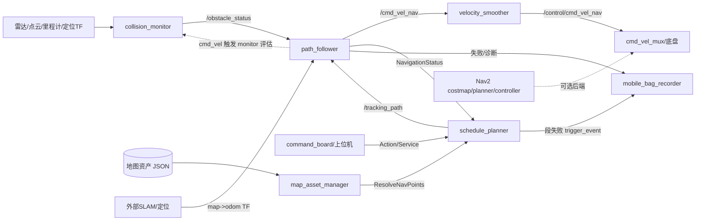

# Dexe Mobile Nav 导航项目架构学习指南

> 开发者视角、职责边界与重构取舍请继续阅读 [Dexe Mobile Nav 开发者理解手册](/home/dex/dexe-mobile-nav/DEVELOPER_GUIDE_CN.md)。本文件保留总体数据流；其中关于 lifecycle 的表述以开发者手册的源码核查为准。

## 1. 项目定位与边界

这是一个 **ROS 2 Humble 风格的移动机器人导航工作区**。仓库把 Nav2 的通用能力与项目自定义的“路线资产、段级轨迹跟踪、安全旁路、任务编排、故障取证”组合起来。

仓库内没有完整 SLAM、传感器驱动或底盘驱动实现：地图/定位通常由外部节点提供（例如 `/map`、`map->odom` TF、`/feedback/odom`），底盘通过最终 `cmd_vel` 消费速度。因此阅读时要把本仓库视为“导航执行与工程增强层”。

核心包：

- `nav_interfaces`：系统契约，定义动作、服务和状态消息，是包间耦合的中心。
- `map_asset_manager`：持久化地图资产（点、路线、区域、房间、拓扑图），并把业务点解析为几何目标。
- `nav2_schedule_planner`：接收一组导航点，按路线段生成 `TrackingPath`，串行执行、取消、超时和失败恢复。
- `path_follower`：30 Hz 左右的段级轨迹跟踪器，完成 TF/里程计融合、速度规划、PID/曲率控制和安全状态机。
- `nav2_collision_monitor`：传感器几何区域的实时 STOP/SLOWDOWN/FREE 评估，向跟踪器发布状态。
- `nav2_costmap_2d`、`nav2_util`：Nav2 的基础设施/本地 fork。
- `command_board`：上层命令、状态、地图版本和后端编排。
- `mobile_bag_recorder`：常态分段录包与故障事件取证。

## 2. 总体架构



推荐入口是 `nav2_schedule_planner/launch/path_navigation_bringup.launch.py`。launch 文件意图用 lifecycle manager 编排两个执行节点，碰撞监控和速度平滑器由各自独立 manager 管理；但当前 `PathFollowerNode` 与 `SchedulePlannerNode` 源码继承的是普通 `rclcpp::Node`，并非 `LifecycleNode`。因此“先激活执行后端”的描述需要在实际部署中核对，不能仅依据 launch 注释认定已经生效。详见开发者手册。

## 3. 完整运行数据流

1. **环境输入**：传感器发布 `LaserScan`/`PointCloud2`/`Range`；外部定位发布 `map->odom` TF，底盘发布 `/feedback/odom`。
2. **任务进入**：上层向 `navigate_through_graph_points` action 发送点 ID/名称。
3. **资产解析**：schedule planner 调用 `/map_asset_manager/resolve_nav_points`，得到点、路线边和段属性。
4. **轨迹生成**：每个 `PathSegment` 被离散成约 1 cm 的几何轨迹；相邻属性一致的 LINE 段可用 Bezier 合并，减少途经点停车和原地旋转。
5. **轨迹下发**：发布 `nav_interfaces/TrackingPath`。该消息把 mode、倒车、保持朝向、限速、障碍膨胀距离、终点朝向与轨迹绑定，避免旁路参数同步。
6. **定位与跟踪**：path follower 用 TF 得到 map/odom 下机器人位姿，用 odom 做新鲜度看门狗和跳变恢复；按最近点、前视点和曲率计算速度。
7. **安全闭环**：collision monitor 订阅 follower 的速度作为评估触发，同时消费传感器数据。结果发布 `/obstacle_status`；follower 的 `VelocityTrackMode` 做迟滞、减速台阶和停车。其限速后的旁路 `cmd_vel` 刻意不接回主速度链，避免二次刹车。
8. **速度执行**：follower → `velocity_smoother` → 底盘/mux。平滑器限制加速度，底盘执行最终 Twist。
9. **反馈与收尾**：follower 发布 `NavigationStatus`；planner 更新 action feedback，进入下一段、完成或取消。异常通过 `trigger_event` 通知录包节点。

## 4. 核心设计思想

### `nav_interfaces` 是稳定契约
优先阅读 `msg/TrackingPath.msg`、`msg/NavigationStatus.msg`、`msg/ObstacleMonitorStatus.msg` 和 `action/NavigateThroughGraphPoints.action`。消息设计强调“轨迹自描述”：消费者不需要猜测段模式或反查参数。NaN 表示“该字段不约束”，是兼容默认行为的显式协议。

### 规划与控制解耦
schedule planner 只负责业务路线、段切换和轨迹发布；path follower 只负责几何跟踪和实时控制。二者通过 topic + status 协作，因此可以替换 planner 或控制器而不修改资产层。

### 安全通路独立于 costmap
collision monitor 直接在传感器点上做区域判定，绕过 costmap 和全局规划延迟，适合“突然出现的障碍”。STOP/SLOWDOWN 按最激进区域合并。项目增改的 idle keepalive 让障碍状态在没有速度输入时仍可发布，支持 follower 看门狗。

### 故障可复现优先
录包节点把常态流和事件流分开：内存按时间裁剪的环形缓冲保留触发前窗口，触发后继续录制，并异步抓取 systemd journal。模块只依赖 `std_msgs/String` 触发 topic，避免控制器反向依赖录包工具。

## 5. 关键代码阅读路径

1. 先读推荐 launch：`nav2_schedule_planner/launch/path_navigation_bringup.launch.py` 与 `path_follower/launch/path_follower_with_collision_and_smoother.launch.py`。
2. 再读接口：`nav_interfaces/msg/TrackingPath.msg`、`ObstacleMonitorStatus.msg`、相关 action/service。
3. 读 planner 主流程：`nav2_schedule_planner/src/schedule_planner_node.cpp`，再看 `path_segment_sampler.cpp`、`segment_merger.cpp`。
4. 读控制循环：`path_follower/src/path_follower.cpp` 的构造、`onTrackingPath`、`onOdom`、`onObstacleStatus`、`update`；速度约束集中在 velocity planner/Ruckig 和 PID 参数。
5. 读安全判断：`nav2_collision_monitor/src/collision_monitor_node.cpp`，以及 `polygon.cpp`、`circle.cpp`、`scan.cpp`、`pointcloud.cpp`。
6. 读资产存储：`map_asset_manager/src/*_manager`、`route_graph_manager`、`file_manager`。
7. 最后读 `command_board` 和 `mobile_bag_recorder`，理解任务状态汇总及故障现场保留。

## 6. 修改、扩展与调试方法

### 修改核心算法
- 改轨迹几何：从 `path_segment_sampler` 入手，保持 `TrackingPath` 的姿态/NaN 协议。
- 改跟踪器：修改 `path_follower::update` 及速度规划器；保留“无新 odom、TF 跳变、偏离阈值、障碍 STOP”这些硬停止条件。
- 改安全模型：扩展 `Polygon`/`Source` 派生类，确保传感器坐标转换和最激进动作合并逻辑不变。
- 改业务路线：扩展 asset manager 的 store/manager 和对应 srv，避免把 JSON 读写散落到 planner。

### 现场调试顺序

```bash
ros2 node list
ros2 lifecycle get /path_follower_node
ros2 topic hz /feedback/odom
ros2 topic echo /tracking_path --once
ros2 topic echo /obstacle_status
ros2 topic echo /navigation_status
ros2 topic echo /control/cmd_vel_nav
ros2 service call /schedule_planner/force_cancel std_srvs/srv/Trigger {}
```

若“任务接受但不动”，先查 lifecycle、`/tracking_path`、odom/TF 和 smoother active 状态；若“突然停车”，查 `/obstacle_status`、`zone_name`、odom stale 和 localization jump 日志；若“任务卡住”，查 planner 段超时、`NavigationStatus` 边沿和事件 bag。

## 7. 工程经验与风险点

- launch include 使用 `scoped=True` 并显式传 `params_file`，否则同名参数可能串用而不报错。
- launch 中 lifecycle/bond timeout 的配置意图是覆盖路径加载/舵角 action 等待；但当前两个执行节点是普通 Node，不能把该配置当作已实现的生命周期和 bond 保障。若修复为 LifecycleNode，应重新验证单线程 executor 下的等待与 bond 行为。
- collision monitor 的旁路输出不能接回主链；安全状态由 follower 统一执行。
- `/map` 等 transient_local 话题必须使用发布端匹配的 QoS；录包器已用 QoS 自适配。
- map/odom TF 跳变恢复是控制稳定性的关键，修改定位接口时必须同时验证末端锚定、跳变阈值和 fallback 帧数。
- 本仓库不负责 SLAM 本身；需要集成 SLAM 时，重点是 TF 约定、时间戳、地图服务和 lifecycle，而不是把 SLAM 代码塞进 follower。

## 8. 学习重点

最值得掌握的三条主线是：`TrackingPath` 如何把业务段变成可执行轨迹；`path_follower` 如何把 TF/odom/曲率变成受 jerk 约束的 Twist；`collision_monitor → obstacle_status → VelocityTrackMode` 如何形成独立安全闭环。掌握这三条线后，再扩展地图资产、任务编排和录包功能会比较自然。
