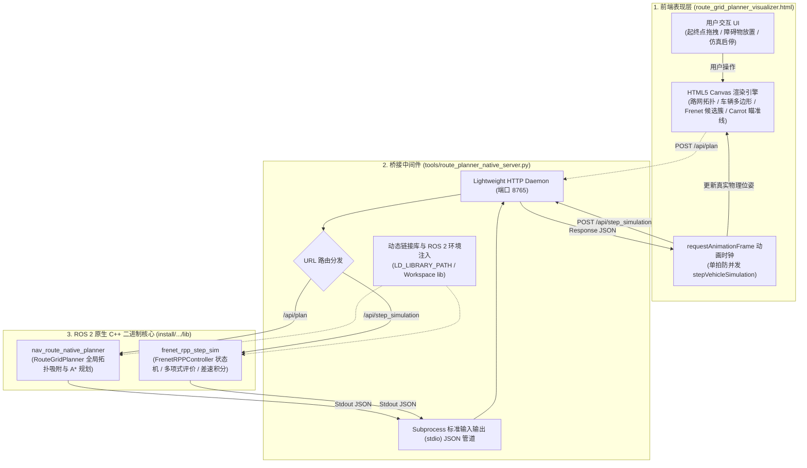
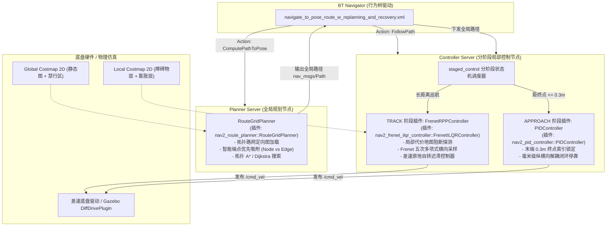
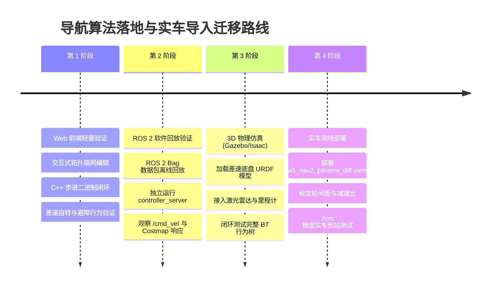

# HTML 交互式仿真运行原理与 ROS 2 Nav2 完整工程化导入设计方案

> **工程路径**：`/home/dex/Desktop/work/kuawei/dexe_mobile_nav`  
> **核心模块**：`nav2_route_planner` | `nav2_frenet_ilqr_controller` | `nav2_pid_controller` | `tools/route_planner_native_server.py` | `docs/route_grid_planner_visualizer.html`  
> **底盘模型**：差速驱动底盘（Differential Drive，零转弯半径原地自转）  
> **文档版本**：v1.0 (2026-10-28)  

---

## 1. 概述与设计背景

在自主移动机器人（AMR）的工业物流应用中，算法的开发调试往往经历三个阶段：
1. **轻量交互式快速原型与可视化验证（当前阶段）**：脱离笨重的 3D 物理引擎（如 Gazebo/Isaac Sim），通过轻量 Web 前端快速验证全局拓扑图吸附、A* 路径搜索、Frenet 五次多项式采样评价与差速 RPP 原地自转逻辑；
2. **ROS 2 节点级管道闭环**：通过原生 IPC/RPC 桥接，保证控制与规划的核心代码 **100% 运行在 C++ 二进制中**，彻底杜绝前端 JS 模拟；
3. **Nav2 系统级完整导入（目标阶段）**：将算法插件无缝注册到 Nav2 的标准生命周期容器（`planner_server`、`controller_server`、`bt_navigator`）中，对接 TF 树、Costmap2D 与真实的驱动底盘。

本文档深度剖析当前 HTML 前端仿真的底层运转机理，并给出端到端无缝迁移至 ROS 2 Nav2 真实环境的系统设计与工程落地方案。

---

## 2. 现行 HTML 前端仿真运行原理深度剖析

### 2.1 系统三层解耦架构

当前系统并非传统意义上的“纯前端 JavaScript 页面”，而是采用 **“前端哑终端显示 + Python 异步桥接服务 + ROS 2 原生 C++ 二进制计算核”** 的三层微服务化架构：



---

### 2.2 坐标系定义与正逆双向数学映射

前端画布与真实 ROS 2 世界采用不同的几何坐标系。前端仿真运行的前提是**数学上严格保真的正逆变换**：

| 坐标系属性 | Web 前端 Canvas 坐标系 | ROS 2 / Nav2 世界坐标系 | 转换比例与换算公式 |
| :--- | :--- | :--- | :--- |
| **原点位置** | 画布左上角 $(0, 0)$ | 地图原点 $(0, 0)$（通常对应左下角） | 比例尺：$1.0\text{ m} = 40.0\text{ px}$ |
| **X 轴朝向** | 水平向右为正 | 水平向前/向右为正 | $x_{\text{ros}} = x_{\text{canvas}} / 40.0$ |
| **Y 轴朝向** | **垂直向下为正** | **垂直向上为正（右手系）** | $y_{\text{ros}} = (H_{\text{canvas}} - y_{\text{canvas}}) / 40.0$ |
| **航向角 $\theta$** | 顺时针旋转为正，以水平向右为 $0$ | 逆时针旋转为正，右手定则 | $\theta_{\text{ros}} = -\theta_{\text{canvas}}$ |
| **角速度 $\omega$** | 顺时针角速度为正 | 逆时针角速度为正 | $\omega_{\text{ros}} = -\omega_{\text{canvas}}$ |

#### 变换实现：
- **请求打包（Canvas $\to$ ROS 2）**：
  ```javascript
  const reqPayload = {
    pose: {
      x: simVehiclePose.x / 40.0,
      y: (canvas.height - simVehiclePose.y) / 40.0,
      yaw: -simVehiclePose.heading,
      v: simVehiclePose.v,
      omega: -simVehiclePose.omega,
      d: simVehiclePose.d
    },
    goal: {
      x: robotGoal.x / 40.0,
      y: (canvas.height - robotGoal.y) / 40.0,
      yaw: -robotGoal.heading
    },
    obstacle: {
      x: dynamicObstacle.x / 40.0,
      y: (canvas.height - dynamicObstacle.y) / 40.0,
      active: dynamicObstacle.active && avoidanceEnabled
    },
    path_points: refPath.map(pt => ({
      x: pt.x / 40.0,
      y: (canvas.height - pt.y) / 40.0
    })),
    dt: dt
  };
  ```
- **反馈解包（ROS 2 $\to$ Canvas）**：
  ```javascript
  simVehiclePose.x = res.pose.x * 40.0;
  simVehiclePose.y = canvas.height - res.pose.y * 40.0;
  simVehiclePose.heading = normalizeAngle(-res.pose.yaw);
  simVehiclePose.v = res.pose.v;
  simVehiclePose.omega = -res.cmd_vel.omega;
  // 前视 Carrot 点逆映射回画布用于粉色瞄准线绘制
  simRPPData.lookaheadPt = {
    x: res.rpp_data.lookahead_pt.x * 40.0,
    y: canvas.height - res.rpp_data.lookahead_pt.y * 40.0
  };
  ```

---

### 2.3 单步仿真时钟与并发防重入控制

为保证 Web 端的平滑运行且不阻塞浏览器渲染主线程，前端采用异步帧驱动模型：
1. **动画驱动**：通过 `window.requestAnimationFrame(stepVehicleSimulation)` 保持 $60\text{ fps}$ 的刷新节奏；
2. **并发锁（In-flight Lock）**：
   引入 `let isSimStepInFlight = false;` 标志位。因为 HTTP 请求经过 Python 派生子进程执行 C++ 二进制，单拍耗时约 $2\text{ms} \sim 8\text{ms}$。若上一拍的 HTTP 响应尚未返回，当前帧直接跳过请求，防止服务端进程堆叠与网络拥塞；
3. **真实物理积分**：
   小车物理坐标的位移和航向积分并不是前端计算的，而是 C++ 原生节点内部执行的一阶 Runge-Kutta / 差速运动学模型：
   $$\begin{cases}
   x_{k+1} = x_k + v_k \cos(\theta_k) \cdot \Delta t \\
   y_{k+1} = y_k + v_k \sin(\theta_k) \cdot \Delta t \\
   \theta_{k+1} = \theta_k + \omega_k \cdot \Delta t
   \end{cases}$$
   当状态机处于 `ROTATE_TO_PATH` 或 `ROTATE_TO_GOAL` 时，线速度强制 $v_k = 0$，保证了纯原地无平移自转。

---

## 3. 为什么能够无缝导入 ROS 2 Nav2？

当前架构在设计之初就严格遵循了 ROS 2 和 Nav2 的工业级标准，而不是编写孤立的 Mock 脚本：
1. **核心算法 100% C++ 化**：
   - 全局路径规划由 [`nav2_route_planner`](file:///home/dex/Desktop/work/kuawei/dexe_mobile_nav/mobile_navigation/nav2_route_planner) 提供；
   - 局部横向五次多项式采样由 [`frenet_trajectory_planner`](file:///home/dex/Desktop/work/kuawei/dexe_mobile_nav/mobile_navigation/frenet_trajectory_planner) 提供；
   - 差速跟踪控制与状态机由 [`nav2_frenet_ilqr_controller`](file:///home/dex/Desktop/work/kuawei/dexe_mobile_nav/mobile_navigation/nav2_frenet_trajectory_planner)（类名 `FrenetILQRController`）提供；
   - 终点高精度进站停靠由 [`nav2_pid_controller`](file:///home/dex/Desktop/work/kuawei/dexe_mobile_nav/mobile_navigation/nav2_modules/controllers/nav2_pid_controller) 提供。
2. **纯粹的标准接口封装**：
   仿真的二进制（`frenet_rpp_step_sim`）实际上是提取了 C++ 控制器核心逻辑的独立测试执行器。这意味着，**不需要重写任何控制和规划算法，只需将其注册为标准的 Nav2 插件并配置参数，即可直接在真机或 Gazebo/Isaac Sim 中跑通**。

---

## 4. 后续完整导入 ROS 2 Nav2 的系统设计方案

### 4.1 Nav2 插件层级架构设计

在完整的 ROS 2 Nav2 导航堆栈中，各组件的挂载架构如下：



---

### 4.2 核心接口与 ROS 2 话题/Action 通信规范

导入 Nav2 后，前端使用的 HTTP JSON 管道将被标准 ROS 2 接口全面替换：

| 逻辑环节 | 现行 HTML 仿真接口 | Nav2 真实环境标准接口 | 消息类型 / 描述 |
| :--- | :--- | :--- | :--- |
| **导航目标输入** | 前端鼠标拖拽 `robotGoal` | `/navigate_to_pose` (Action) | `nav2_msgs/action/NavigateToPose`<br/>包含目标坐标与朝向四元数 |
| **全局参考路径** | `POST /api/plan` | `/plan` (Topic) 或 Action 结果 | `nav_msgs/msg/Path`<br/>由 `RouteGridPlanner` 规划出的离散路网点列 |
| **当前位姿输入** | HTTP 请求中的 `pose` 字段 | `/tf` 坐标树与 `/feedback/odom` | 转换从 `map` $\to$ `odom` $\to$ `base_link` 的真实 TF 变换 |
| **局部环境感知** | 前端 `dynamicObstacle` 坐标 | `/local_costmap/costmap_raw` | `nav2_costmap_2d::Costmap2DROS`<br/>由激光雷达与深度相机实时生成的占据栅格 |
| **底盘驱动输出** | HTTP 返回的 `cmd_vel` | `/cmd_vel` 或 `/cmd_vel_nav` | `geometry_msgs/msg/Twist`<br/>包含线速度 $v_x$ 与角速度 $\omega_z$ |
| **状态机与诊断** | HTTP 返回的 `state_desc` | `~/fsm_state` 与诊断监控 | `std_msgs/msg/String`、`/diagnostics`<br/>实时回显当前运行状态 |
| **可视化监控** | Canvas 绘制 | `/transformed_global_plan`、`~/lookahead_carrot` | 在 RViz2 中原生订阅显示前瞻点与参考路径 |

---

### 4.3 行为树（Behavior Tree）定制与调度设计

在 [`mobile_navigation/nav2_bt_navigator/behavior_trees/navigate_to_pose_route_w_replanning_and_recovery.xml`](file:///home/dex/Desktop/work/kuawei/dexe_mobile_nav/mobile_navigation/nav2_bt_navigator/behavior_trees/navigate_to_pose_route_w_replanning_and_recovery.xml) 中，专为路网场景设计的行为树拓扑结构如下：

```xml
<root main_tree_to_execute="MainTree">
  <BehaviorTree ID="MainTree">
    <RecoveryNode number_of_retries="6" name="NavigateRecovery">
      <PipelineSequence name="NavigateWithReplanning">
        
        <!-- 1. 全局路网拓扑规划：绑定 RouteGridPlanner -->
        <RateController hz="0.05">
          <RecoveryNode number_of_retries="1" name="ComputePathRecovery">
            <ComputePathToPose goal="{goal}" path="{path}" planner_id="RouteGridPlanner"/>
            <ClearEntireCostmap name="ClearGlobalCostmap-Context" service_name="global_costmap/clear_entirely_global_costmap"/>
          </RecoveryNode>
        </RateController>
        
        <!-- 2. 局部控制器分阶段追踪：由 ControllerServer 自动分流 FrenetRPP 与 PID -->
        <RecoveryNode number_of_retries="1" name="FollowPathRecovery">
          <FollowPath path="{path}" controller_id="FrenetRPPController"/>
          <ClearEntireCostmap name="ClearLocalCostmap-Context" service_name="local_costmap/clear_entirely_local_costmap"/>
        </RecoveryNode>

      </PipelineSequence>

      <!-- 3. 故障自愈恢复子树：差速原地自转与安全微退 -->
      <ReactiveFallback name="RecoveryFallback">
        <GoalUpdated/>
        <RoundRobin name="RecoveryActions">
          <Spin spin_dist="1.57"/> <!-- 差速原地自转探视 -->
          <BackUp backup_dist="0.30" backup_speed="0.10"/> <!-- 障碍脱困后退 -->
          <Wait wait_duration="2.0"/>
        </RoundRobin>
      </ReactiveFallback>
    </RecoveryNode>
  </BehaviorTree>
</root>
```

---

### 4.4 参数配置落地方案（`w1_nav2_params_diff.yaml`）

在实车参数文件 [`mobile_navigation/nav2_bringup/params/w1_nav2_params_diff.yaml`](file:///home/dex/Desktop/work/kuawei/dexe_mobile_nav/mobile_navigation/nav2_bringup/params/w1_nav2_params_diff.yaml) 中进行标准配置：

```yaml
planner_server:
  ros__parameters:
    expected_planner_frequency: 1.0
    planner_plugins: ["RouteGridPlanner"]
    RouteGridPlanner:
      plugin: "nav2_route_planner::RouteGridPlanner"
      route_network_file: "/home/dex/Desktop/work/kuawei/dexe_mobile_nav/docs/custom_route_network.json"
      endpoint_snap_node_threshold: 0.40  # 离节点小于 0.4m 优先吸附至节点，规避单向边锁死
      interpolation_step: 0.05

controller_server:
  ros__parameters:
    controller_frequency: 25.0
    controller_plugins: ["FrenetRPPController", "RPPController", "PIDController"]
    current_controller: "FrenetRPPController"

    # 宏观分阶段控制器（Staged Control）核心配置
    staged_control:
      enabled: True
      track_controller: "FrenetRPPController" # 巡航主跟踪
      approach_controller: "PIDController"    # 终点 0.3m 接管
      approach_distance: 0.30
      align_heading_tolerance: 0.13           # 约 7.5°
      align_angular_kp: 1.0

    # 巡航阶段：FrenetRPPController
    FrenetRPPController:
      plugin: "nav2_frenet_ilqr_controller::FrenetILQRController"
      lookahead_dist: 0.60
      min_lookahead_dist: 0.30
      max_lookahead_dist: 0.90
      lookahead_time: 1.50
      desired_linear_vel: 0.80
      max_angular_vel: 1.50
      # 差速底盘原地自转双门限迟滞
      use_rotate_to_heading: True
      rotate_to_path_entry_angle: 0.75        # 43° 切入自转
      rotate_to_path_exit_angle: 0.32         # 18° 恢复前进
      rotate_to_path_angular_vel: 0.50
      rotate_to_goal_angular_vel: 0.50
      # 障碍探测与多项式避障
      enable_state_machine: True
      obstacle_check_distance: 2.50
      obstacle_cost_threshold: 253

    # 进站阶段：PIDController
    PIDController:
      plugin: "nav2_pid_controller::PIDController"
      final_target_lock_distance: 0.30
      long_precision: 0.02                    # 纵向 2cm
      lat_precision: 0.02                     # 横向 2cm
      o_precision: 0.05                       # 航向约 2.8°
      speed_loop_overspeed_undercut_gain: 0.50
```

---

## 5. 从仿真到真机的逐步迁移验证路线图



### 实施步骤清单：
1. **环境准备与编译**：
   ```bash
   cd /home/dex/Desktop/work/kuawei/dexe_mobile_nav
   colcon build --packages-select nav2_route_planner nav2_frenet_ilqr_controller nav2_pid_controller
   source install/setup.bash
   ```
2. **启动 Nav2 系统节点**：
   ```bash
   ros2 launch nav2_bringup bringup_launch.py \
     params_file:=/home/dex/Desktop/work/kuawei/dexe_mobile_nav/mobile_navigation/nav2_bringup/params/w1_nav2_params_diff.yaml \
     use_sim_time:=False
   ```
3. **RViz2 监控与目标发布**：
   - 打开 RViz2，添加 `Path`（话题 `/plan` 与 `FrenetRPPController/tracking_path`）；
   - 添加 `PointStamped`（话题 `FrenetRPPController/lookahead_carrot`）；
   - 使用 **2D Goal Pose** 标定终点工位，观察控制台状态机跃迁日志：
     ```text
     [controller_server]: Staged control on: track='FrenetRPPController', approach='PIDController'
     [FrenetRPPController]: DIRECT_RPP: 无障碍物，路网参考线直通纯追踪
     [FrenetRPPController]: FRENET_AVOID: 前方车道受阻，Frenet 五次多项式横向避障
     [controller_server]: Control choice: approach, goal_distance=0.28m, switching to PIDController
     [PIDController]: Reached final position precision (<=0.02m), goal succeeded.
     ```
