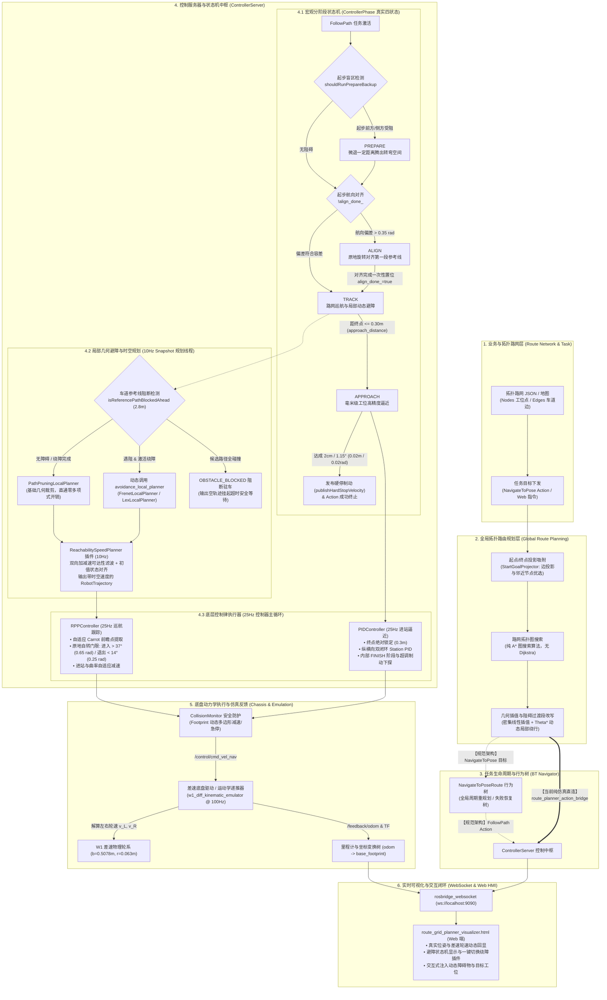
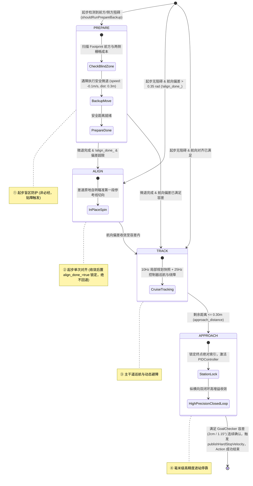
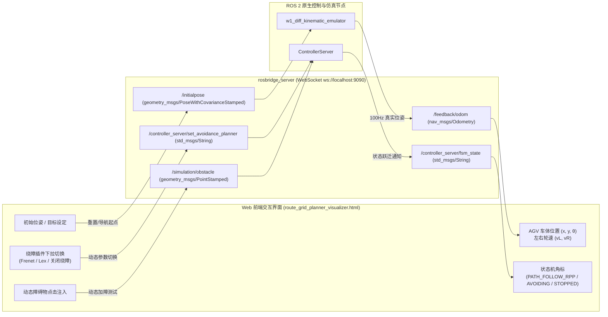

# 拓扑路网到 AGV 小车运动全链路规划控制体系架构

> **工程根目录**：`/home/dex/Desktop/work/kuawei/dexe_mobile_nav`  
> **核心组件**：`nav2_route_planner` | `nav2_controller` (`ControllerServer`) | `nav2_path_pruning_local_planner` | `nav2_frenet_trajectory_planner` | `nav2_lex_local_planner` | `nav2_regulated_pure_pursuit_controller` | `nav2_pid_controller` | `w1_diff_gazebo`  
> **底盘模型**：W1 差速驱动底盘（严格遵循 [`w1_diff_sim.urdf`](file:///home/dex/Desktop/work/kuawei/dexe_mobile_nav/mobile_simulation/diff-sim-container/src/w1_diff_gazebo/urdf/w1_diff_sim.urdf)：轮距 $B=0.5078\text{ m}$，轮径 $D=0.126\text{ m}$，支持零转弯半径原地自转）  
> **更新日期**：2026-10-29  

---

## 1. 全链路架构总览（End-to-End Architecture Overview）

从业务下发拓扑路网与目标工位，到 AGV 差速小车平稳、安全、高精度停靠目标工位，整个规划与控制执行链路划分为 **6 大核心层级**：



---

## 2. 链路第一环：路网拓扑定义与任务下发（Route Network & Task Dispatch）

### 2.1 拓扑路网数据模型（Route Graph Model）
路网定义存储于专用拓扑数据文件（如 [`custom_route_network.json`](file:///home/dex/Desktop/work/kuawei/dexe_mobile_nav/docs/custom_route_network.json)）中：
* **节点集合（Nodes）**：定义站台工位、通道拐弯点、十字路口等物理关键点。每个节点包含：
  $$\text{Node}_i = \left\{ \text{id}, x, y, z, \text{yaw}, \text{type: [WORKSTATION | INTERSECTION | CHARGING]} \right\}$$
* **边集合（Edges）**：定义允许小车通行的物理车道线。每条边包含：
  $$\text{Edge}_k = \left\{ \text{from\_id}, \text{to\_id}, \text{direction: [ONE\_WAY | BI\_DIRECTIONAL]}, \text{max\_speed}, \text{width}, \text{curve\_type: [LINE | BEZIER | CIRCLE]} \right\}$$

### 2.2 任务发起与目标下发
* **接口形式**：由调度系统或 Web 仿真界面向 Nav2 标准 Action 发起目标：
  * Action 类型：`nav2_msgs::action::NavigateToPose` 或 `NavigateThroughPoses`；
  * 目标位姿包含世界坐标系下的 $(x_g, y_g, \theta_g)$。

---

## 3. 链路第二环：全局拓扑路由规划（Global Route Planning）

全局规划器服务由 [`nav2_route_planner`](file:///home/dex/Desktop/work/kuawei/dexe_mobile_nav/mobile_navigation/nav2_route_planner) 承担，通过 ROS 2 插件 `nav2_route_planner::NavRouteGraphPlanner` 暴露给 `planner_server`：

### 3.1 起点/终点投影吸附（`StartGoalProjector`）
* **定位吸附**：AGV 启动时往往停在工位或通道旁，并不一定严格处于路网几何线上。
* [`StartGoalProjector`](file:///home/dex/Desktop/work/kuawei/dexe_mobile_nav/mobile_navigation/nav2_route_planner/include/nav2_route_planner/start_goal_projector.hpp) 遍历全场 Edges，寻找与当前位姿 $(x_s, y_s)$ 投影欧氏距离最近、且切向与航向最接近的边 $E_{\text{start}}$，求出垂直垂足点 $P_{\text{proj}}$；
* 对目标工位 $(x_g, y_g)$ 执行相同投影吸附，得到终点吸附点；
* 若起点偏离主路网，自动生成一段由当前位置平滑汇入主路网的过渡过渡线（Transition Lead-in）。

### 3.2 拓扑图搜索（Graph Topological Search）
* 构建加权有向图 $G = (V, E)$，边权综合考虑：
  $$W(E_k) = \frac{\text{Length}(E_k)}{v_{\max}(E_k)} + \text{Penalty}_{\text{turn}} + \text{Penalty}_{\text{traffic}}$$
* 运行 A* 算法（核心由 [`astar_searcher.cpp`](file:///home/dex/Desktop/work/kuawei/dexe_mobile_nav/mobile_navigation/nav2_route_planner/src/astar_searcher.cpp) 实现，系统内无 Dijkstra 算法），启发函数采用 2D 欧几里得距离，在毫秒级内输出最优拓扑边序列：
  $$\text{Route} = [E_1, E_2, \dots, E_m]$$

### 3.3 几何曲线插值与局部阻碍过渡改写（Curve Interpolation & Transition Rewriting）
* **无独立全局平滑器**：系统并未部署如 `nav2_smoother` 之类的独立全局平滑进程或算法节点，全局参考线的几何连续性与避障平滑主要通过以下两层机制完成：
  * **密集线性插值（`path_interpolator.cpp`）**：对选中的拓扑边以高密度空间分辨率（默认 $\Delta s = 0.05\text{ m} \sim 0.10\text{ m}$）进行切向对齐插值，保证航向角连续一致；
  * **阻碍段过渡改写与避障曲线拼接（`costmap_aware_layer.cpp`）**：当全局代价地图检测到车道边受静态阻碍时，调用 $\Theta^*$ 算法就地搜索几何拐点，动态改写阻碍段路径并拼接平滑过渡曲线；
  * **曲线几何段支持**：圆弧段基于曲率 $\kappa = \pm 1/R$ 离散化，拐弯贝塞尔过渡段保证二阶导连续（Jerk 连续）。
* 最终拼接成全局参考路径 `global_path`（`nav_msgs::msg::Path`），发布至话题 `/plan`。

---

## 4. 链路第三环：任务生命周期与行为树（BT Navigator）

### 4.1 规范架构（实车量产链路）
* **载入行为树**：[`navigate_to_pose_route_w_replanning_and_recovery.xml`](file:///home/dex/Desktop/work/kuawei/dexe_mobile_nav/mobile_navigation/nav2_bt_navigator/behavior_trees/navigate_to_pose_route_w_replanning_and_recovery.xml)；
* **工作流调度**：
  1. 通过 `ComputePathToPose` 调用全局规划器获取全局参考路径；
  2. 周期性（如 1Hz ~ 2Hz）监控参考线可行性；若遇到大面积静态死锁障碍物，触发拓扑重规划；
  3. 通过 `FollowPath` Action 客户端将参考线交由 `ControllerServer`，持续接收控制反馈（Feedback：剩余距离、当前航速、规划误差）；
  4. 若控制器超时或报错，行为树按策略触发自转排障、后退脱困或报警停机。

### 4.2 当前纯仿真运行现状（仿真轻量旁路模式）
* **现状说明**：在当前的纯仿真环境（[`w1_diff_pure_sim.launch.py`](file:///home/dex/Desktop/work/kuawei/dexe_mobile_nav/mobile_simulation/diff-sim-container/src/w1_diff_gazebo/launch/w1_diff_pure_sim.launch.py)）中，**未启动 `bt_navigator` 节点**；
* **直调桥接**：Web 前端下发参考路径到 `/route_planner/global_path` 后，由 [`tools/route_planner_action_bridge.py:68`](file:///home/dex/Desktop/work/kuawei/dexe_mobile_nav/tools/route_planner_action_bridge.py#L68) 直接作为 Action 客户端调用 `ControllerServer` 的 `/follow_path` Action；路网专用 BT XML 虽已存在，但在当前纯仿真中处于完全旁路状态；
* **仿真接入行为树工程演进方案**：
  1. 将 `nav2_route_planner` 包装为继承 `nav2_core::GlobalPlanner` 的标准 ROS 2 插件，对接 `ComputePathToPose`；
  2. 在 `w1_diff_pure_sim.launch.py` 中增加 `bt_navigator` 节点，并由 `lifecycle_manager_pure_sim` 统一纳管；
  3. 前端改为通过 Action 客户端直接向 `/navigate_to_pose` 下发目标，彻底废除 Python 临时桥接脚本。

---

## 5. 链路第四环：控制服务器核心中枢（ControllerServer）

[`ControllerServer`](file:///home/dex/Desktop/work/kuawei/dexe_mobile_nav/mobile_navigation/nav2_controller/include/nav2_controller/controller_server.hpp) 承担了整个系统的大脑中枢职责，采用**双线程解耦架构**：
* **10Hz 规划快照线程（Snapshot Worker Thread）**：负责几何路径裁剪、避障状态机判定、多项式采样与 ReachabilitySpeedPlanner 速度剖面计算；
* **25Hz 控制主线程（Control Loop Thread）**：负责高频传感器闭环、宏观四阶段切换、差速原地自转判定与底盘控制律解算。

```mermaid
sequenceDiagram
    autonumber
    participant BT as BT Navigator / Action Bridge (FollowPath)
    participant CS_Main as ControllerServer 主循环 (25Hz)
    participant CS_Snap as 快照规划线程 (10Hz)
    participant Costmap as Local Costmap2D
    participant LP as LocalPlanner 插件池
    participant SP as ReachabilitySpeedPlanner (10Hz 规划插件)
    participant RPP as RPP / PID 控制器

    BT->>CS_Main: 下发全局参考路径 global_path
    Note over CS_Main: 若起步遇阻执行 PREPARE 微退；若航向偏差 > 0.35 rad 执行单次 ALIGN
    CS_Main->>CS_Snap: 触发快照请求 request(pose, velocity, path)
    CS_Snap->>Costmap: isReferencePathBlockedAhead (探测前瞻 2.8m)
    
    alt 前方车道有障碍 & 配置了避障插件
        CS_Snap->>LP: 调用 avoidance_local_planner->computeLocalPlan()
        LP-->>CS_Snap: 输出横向无碰撞五次多项式路径 avoid_path
    else 无障碍 / 未配置避障插件
        CS_Snap->>LP: 调用 current_local_planner (PathPruningLocalPlanner)
        LP-->>CS_Snap: 几何裁剪输出 local_path (零多项式计算开销)
    end

    CS_Snap->>SP: computeSpeedPlan(local_path, boundary)
    SP-->>CS_Snap: 生成附带时间戳与限速剖面的 RobotTrajectory
    CS_Snap-->>CS_Main: 更新快照规划结果 snapshot_result

    Note over CS_Main: 进入 25Hz 控制闭环
    alt 距终点 > 0.3m (TRACK 阶段)
        CS_Main->>RPP: 执行 RPPController 纯追踪
        alt 前瞻偏角 |α| > 37° (0.65 rad) (急弯/掉头)
            RPP-->>CS_Main: 强制 v=0, 输出纯原地自转角速度 ω (收敛至 |α| < 14° / 0.25 rad 恢复巡航)
        else 正常航向
            RPP-->>CS_Main: 输出结合曲率/进站减速的 (v, ω)
        end
    else 距终点 <= 0.3m (APPROACH 阶段)
        CS_Main->>PID: 切换至 PIDController (终点锁定 + 纵横向双闭环)
        PID-->>CS_Main: 毫米级高精度收敛至工位停靠点
    end
    CS_Main->>/control/cmd_vel_nav: 发布底盘速度指令 (v, ω)
```

---

### 5.1 宏观分阶段状态机（Staged Control FSM）

宏观分阶段状态机定义于 [`controller_server.hpp`](file:///home/dex/Desktop/work/kuawei/dexe_mobile_nav/mobile_navigation/nav2_controller/include/nav2_controller/controller_server.hpp#L71)：
```cpp
enum class ControllerPhase { PREPARE, ALIGN, TRACK, APPROACH };
```
> **架构要点**：
> * **无 `STOPPED` 阶段**：系统在 `ControllerPhase` 枚举中仅设计了上述 4 个受控运动阶段，不存在 `STOPPED` 枚举状态。车辆在 `APPROACH` 阶段达成高精度容差后，由连续确认机制触发 `publishHardStopVelocity()` 发布硬停速度并结束 `FollowPath` Action；进站控制器（`PIDController`）内部自身维护其末端 `FINISH` 阶段。
> * **PREPARE 条件触发**：非必经流程，仅在起步时盲区检测（`shouldRunPrepareBackup()`）发现前方或侧方有障碍物时执行微退（$-0.1\text{ m/s}$，退距 $0.3\text{ m}$）；起步无阻碍时直接跳过。
> * **ALIGN 单次对齐**：仅在本次导航开始且尚未对齐过（`!align_done_`）时评估。当朝向偏差 $> 0.35\text{ rad}$ 时执行差速原地自转；一旦航向收敛即置位 `align_done_ = true` 并永久锁定。进入 `TRACK` 巡航后，中途遇大折角或绕障偏航绝不回退至 `ALIGN`，而是由 `RPPController` 内部的原地自转机制就地纠偏。



---

### 5.2 局部几何避障状态机（Avoidance FSM @ 10Hz 快照线程）

位于 [`controller_server.cpp::computeLocalPath()`](file:///home/dex/Desktop/work/kuawei/dexe_mobile_nav/mobile_navigation/nav2_controller/src/controller_server.cpp#L1230-L1303)：

#### 1. 触发探测（`isReferencePathBlockedAhead`）
* 从离当前位姿最近的参考点开始，沿全局参考线向前积分前瞻弧长 $s \in [0, 2.80\text{ m}]$；
* 将路径点坐标映射到局部 Costmap2D：
  $$\text{Cost}(mx, my) \ge \text{obstacle\_cost\_threshold} \;(253) \quad \text{或属于} \quad \{\text{LETHAL}, \text{INSCRIBED}\}$$
  一旦发现前方车道被侵占，立即置 `need_avoidance = true`。

#### 2. 可选避障与优雅回退
* **未配置避障插件（`avoidance_local_planner: ""` 或 `"none"`）**：
  * 系统处于纯巡航模式，自动回退到 `current_local_planner`（[`PathPruningLocalPlanner`](file:///home/dex/Desktop/work/kuawei/dexe_mobile_nav/mobile_navigation/nav2_bringup/params/w1_nav2_params_diff.yaml#L140-L146)）；
  * 仅做几何路径投影与裁剪，单周期计算时间 $< 0.1\text{ ms}$，前方遇障由底层 RPP 的遇障减速/停障机制处理。
* **配置了避障插件（`avoidance_local_planner: "FrenetLocalPlanner"` 或 `"LexLocalPlanner"`）**：
  * **遇障触发**：进入 `AVOIDING_OBSTACLE` 状态，调用选定插件生成横向避障多项式路径；
  * **回中与退出避障**：前方无障碍物且横向偏差收敛至阈值内（$|d| \le 0.12\text{ m}$）时，状态机平滑切回 `NORMAL_TRACK`，无缝切回 `PathPruningLocalPlanner`；
  * **全阻断紧急制动**：若避障插件的所有采样候选轨迹均发生碰撞，状态机进入 `OBSTACLE_BLOCKED`，输出空路径并返回 `false`，上层快照抛出异常触发底层刹车急停，避免发生硬撞。
* **在线动态切换**：
  * 订阅话题 `/controller_server/set_avoidance_planner`（`std_msgs::msg::String`），接收字符串（如 `"FrenetLocalPlanner"`、`"LexLocalPlanner"` 或 `""`），无需重启节点即可在线切换避障算法。

---

### 5.3 插件池设计（纯净 LocalPlanner 插件）

在重构后的体系中，插件只负责几何计算，不直接控制底盘速度，保持职责高度内聚：

| 插件名称 | 继承接口 | 核心原理 | 性能与适用场景 |
| :--- | :--- | :--- | :--- |
| **`PathPruningLocalPlanner`** | `nav2_core::LocalPlanner` | 基础几何裁剪规划器。沿全局参考线寻找最近投影点，向前保留剩余全部有效路径供速度规划，不产生横向偏移。 | 极轻量，单次开销 $<0.05\text{ ms}$。**巡航无障碍时的默认基础插件**。 |
| **`FrenetLocalPlanner`** | `nav2_core::LocalPlanner` | Frenet 坐标系五次多项式采样。在横向展开多条候选多项式轨迹：<br/>$d(t) = a_0 + a_1 t + \dots + a_5 t^5$<br/>在横向偏移区间 $[-1.5, 1.5]\text{ m}$ 采样，结合离参考线代价、平滑代价与障碍物安全净空代价选优。 | 平滑性优异，对齐差速底盘车体轮廓。**推荐的主力避障插件**。 |
| **`LexLocalPlanner`** | `nav2_core::LocalPlanner` | 字典序多目标优化（Lexicographic Planning）。生成多条横向 Rollouts，按碰撞、距离、平滑度等优先级阶梯过滤选择最佳轨迹。 | 候选轨迹直观，多约束边界清晰，与 Frenet 插件平行可选。 |

---

### 5.4 速度剖面与底层双控制器（RPP + PID）

#### 1. 速度规划（`ReachabilitySpeedPlanner` @ 10Hz 快照线程插件）
* **架构归属**：速度规划并非独立的 25Hz 节点进程，而是实现了 `nav2_core::SpeedPlanner` 的插件（参数 `current_speed_planner: "ReachabilitySpeedPlanner"`），由 `ControllerServer` 内部的 10Hz 快照线程异步调用；
* **可达性滤波机制**：采用纯可达性滤波后端（后向减速 + 前向加速 + 向下可达，均严格受控于最大加速度与 Jerk 斜率约束），无求解分支，杜绝无解与兜底跳变；
* **起点运动状态继承（`InitialMotion` 仲裁）**：
  * 正常跟踪时，规划起点优先从上一周期已接受计划的空间匹配点继承目标速度与加速度；
  * 仅当与实测状态偏差超过容差门限时才重新回到实测里程计重初始化，消灭离散噪声引发的规划起点 Jerk 抖动；
* **产出物**：生成携带时间戳、速度 $v$、加速度 $a$ 和曲率 $\kappa$ 的 `nav_interfaces::msg::RobotTrajectory`，交由 25Hz 控制线程消费。

#### 2. 大范围巡航跟踪器（`RPPController` @ 25Hz 控制主线程）
* **自适应 Carrot 点提取**：前视距离 $L = \text{clamp}(|v| \cdot t_{\text{lookahead}}, L_{\min}, L_{\max})$，沿轨迹提取前视点 $(x_c, y_c)$；
* **差速大偏角原地自转控制律**：
  * 计算车体瞄准偏角 $\alpha = \text{atan2}(y_c, x_c)$；
  * **切入门限**：若 $|\alpha| > 37.24^\circ$（$0.65\text{ rad}$，`rotate_to_path_entry_angle`），判定为直角拐弯或大角度偏离，**强制线速度清零（$v = 0.0$）**，启动差速左右轮反向旋转，输出纯角速度 $\omega = \text{clamp}(k_p \cdot \alpha, -\omega_{\max}, \omega_{\max})$（$k_p=1.5, \omega_{\max}=0.8\text{ rad/s}$）原地快速自转；
  * **退出门限**：当原地转向使航向收敛至 $|\alpha| < 14.32^\circ$（$0.25\text{ rad}$，`rotate_to_path_exit_angle`）时，平滑退出自转并恢复前行；
  * **优势**：保证小车在平滑绕障曲线段连续行进，仅在遇到大折角时触发原地自转，彻底消除冲出车道的风险。
* **双重受控减速**：结合转弯曲率减速与进站剩余距离减速，稳定输出 $(v, \omega)$。

#### 3. 终点高精度逼近器（`PIDController` @ 25Hz 控制主线程）
当距离终点 $\le 0.30\text{ m}$ 时，系统切入 `APPROACH` 阶段：
* **为什么必须切换到 PIDController？**  
  RPP 在 $L \to 0$ 时产生几何奇异（曲率 $\kappa = \frac{2\sin\alpha}{L} \to \infty$），导致小车在终点极小范围内剧烈震荡揉车；
* **核心机制**：
  * **终点索引绝对锁定**：锁定全局终点位姿，消除投影点跳变；
  * **纵横向双闭环 Station PID**：高速段激活积分抗饱和，微速段高增益精密消除稳态误差；
  * **超调补刹与下探保护**：实车测速超速时施加反向制动下探，接近目标零速点时自动收回，消除进站抖动；
  * **精度达标**：由 `high_precision_goal_checker` 进行严格校验，将纵向与横向残余偏差彻底压制在 $\le \pm 2\text{ cm}$（$0.02\text{ m}$），航向误差 $\le 0.02\text{ rad} \approx 1.15^\circ$。连续确认达成后触发硬停并结束任务。

---

## 6. 链路第五环：底盘安全防护与差速动力学执行（Chassis Dynamics & Emulation）

### 6.1 碰撞监控（`CollisionMonitor`）
在速度指令发送给物理底盘前，由 `nav2_collision_monitor` 进行最后一道安全把关：
* 依据小车激光雷达（前后双激光）和深度相机点云，构建动态安全多边形：
  * **Slowdown 区**：减速至 $30\%$；
  * **Stop 区**：完全停障；
  * **Emergency Stop 区**：硬件级硬停。

### 6.2 差速轮系动力学解算
底盘驱动或仿真器接收速度指令 $(v, \omega)$，依据标准差速逆运动学模型解算左右轮期望线速度：
$$v_L = v - \frac{\omega \cdot B}{2}, \qquad v_R = v + \frac{\omega \cdot B}{2}$$
其中车轮轮距 $B = 0.5078\text{ m}$，车轮半径 $r = 0.063\text{ m}$。车轮期望角速度为：
$$\dot{\phi}_L = \frac{v_L}{r}, \qquad \dot{\phi}_R = \frac{v_R}{r}$$

### 6.3 纯 ROS 2 仿真递推（`w1_diff_kinematic_emulator`）
无需消耗巨大 GPU/CPU 算力拉起重量级 Gazebo，直接通过 [`w1_diff_kinematic_emulator`](file:///home/dex/Desktop/work/kuawei/dexe_mobile_nav/mobile_simulation/diff-sim-container/src/w1_diff_gazebo/src/w1_diff_kinematic_emulator.cpp) 提供高保真运动学递推：
* **递推频率**：$100\text{ Hz}$；
* **物理约束**：最大轮扭矩 $30\text{ N}\cdot\text{m}$，最大车轮加速度 $a_{\max} = 1.0\text{ m/s}^2$；
* **话题与 TF 广播**：
  * 发布 `/feedback/odom`（`nav_msgs::msg::Odometry`）；
  * 广播 `odom -> base_footprint` TF 和 `map -> odom` TF；
  * 30Hz 发布 `/joint_states`（驱动轮关节角度与转速）；
  * 订阅 `/initialpose` 支持一键重置位姿。
* **一键仿真 Launch**：[`w1_diff_pure_sim.launch.py`](file:///home/dex/Desktop/work/kuawei/dexe_mobile_nav/mobile_simulation/diff-sim-container/src/w1_diff_gazebo/launch/w1_diff_pure_sim.launch.py)。

---

## 7. 链路第六环：Web 前端交互与 WebSocket 通信闭环（Web HMI & Monitoring）

### 7.1 通信链路拓扑
* **WebSocket 网关**：`rosbridge_websocket` 监听在 `ws://localhost:9090`；
* **Web 前端页面**：[`route_grid_planner_visualizer.html`](file:///home/dex/Desktop/work/kuawei/dexe_mobile_nav/docs/route_grid_planner_visualizer.html) 通过 `ROSLIB.Ros` 直连 ROS 2 环境。

### 7.2 双向交互数据契约



* **前端功能闭环**：
  1. 实时以高保真 Canvas 绘制 AGV 轮廓、实时航向角、Carrot 前瞻追踪点与五次多项式波束；
  2. 实时显示轮速测量值 $v_L, v_R$ 与底盘加速度；
  3. 提供一键切换绕障插件按钮，实时观测小车在避障状态与直线巡航状态之间的平滑跃迁；
  4. 支持拖拽或点击动态设置障碍物，实时观测多项式绕障路径的动态重构。

---

## 8. 全链路核心话题、服务与参数映射一览表（Cheat Sheet）

| 链路环节 | ROS 2 话题 / 服务名 | 消息类型 / 接口定义 | 关键参数配置（w1_nav2_params_diff.yaml） | 核心作用与流转方向 |
| :--- | :--- | :--- | :--- | :--- |
| **全局规划** | `/plan` | `nav_msgs/msg/Path` | `planner_server.planner_plugins: ["GridRoute"]` | 全局拓扑参考线（纯 A* 搜索，无 Dijkstra；密集插值 + Theta* 改写） |
| **控制 Action** | `/follow_path` | `nav2_msgs/action/FollowPath` | `controller_server.controller_frequency: 25.0` | 控制任务入口（实车由 BT Navigator 下发，纯仿真由 Action Bridge 直调） |
| **避障插件配置** | `/controller_server` | 动态参数 | `local_planner_plugins: ["PathPruningLocalPlanner", "FrenetLocalPlanner", "LexLocalPlanner"]` | 控制服务器加载的局部几何规划插件池 |
| **当前基础规划器** | 内部调用 | `nav2_core::LocalPlanner` | `current_local_planner: "PathPruningLocalPlanner"` | 默认直通无避障的基础几何裁剪插件 |
| **可选绕障插件** | 内部调用 | `nav2_core::LocalPlanner` | `avoidance_local_planner: "FrenetLocalPlanner"` (置空即关闭) | 遇阻时动态调用的横向避障多项式插件 |
| **速度规划插件** | 内部调用 | `nav2_core::SpeedPlanner` | `current_speed_planner: "ReachabilitySpeedPlanner"`<br/>`planning_frequency: 10.0` | 10Hz 快照线程中执行双向可达性滤波与初值继承速度剖面计算 |
| **避障状态机参数** | 内部计算 | 状态机判定 | `avoidance_state_machine.obstacle_trigger_distance: 2.80`<br/>`avoidance_state_machine.rejoin_lateral_threshold: 0.12`<br/>`avoidance_state_machine.obstacle_cost_threshold: 253` | 控制触发绕障与回中回退的几何距离与栅格代价门限 |
| **动态插件切换** | `/controller_server/set_avoidance_planner` | `std_msgs/msg/String` | 运行时动态接收 | 允许外部（如 Web）在线无缝切换绕障算法或关闭避障 |
| **避障状态反馈** | `/controller_server/fsm_state` | `std_msgs/msg/String` | 内部状态机驱动 | 广播 `PATH_FOLLOW_RPP`、`AVOIDING_<Planner>`、`OBSTACLE_BLOCKED` |
| **宏观阶段状态机** | 内部流转 | `ControllerPhase` | `staged_control.enabled: True`<br/>`staged_control.approach_distance: 0.30`<br/>`staged_control.align_heading_tolerance: 0.13` | 控制 PREPARE ➔ ALIGN ➔ TRACK ➔ APPROACH 切换（无 STOPPED 阶段） |
| **巡航控制器** | 内部调用 | `nav2_core::Controller` | `staged_control.track_controller: "RPPController"`<br/>`use_rotate_to_heading: True` (entry: 37° / 0.65 rad, exit: 14° / 0.25 rad) | TRACK 阶段大范围长距离前瞻巡航与差速原地自转 |
| **进站控制器** | 内部调用 | `nav2_core::Controller` | `staged_control.approach_controller: "PIDController"`<br/>`high_precision_goal_checker: 0.02m / 0.02rad (1.15°)` | APPROACH 阶段最后 30cm 毫米级终点锁定与高精度工位停靠 |
| **控制速度发布** | `/control/cmd_vel_nav` | `geometry_msgs/msg/Twist` | 由 ControllerServer 25Hz 输出 | 规划控制层解算出的无碰撞期望底盘速度 |
| **碰撞门禁输出** | `/control/cmd_vel` | `geometry_msgs/msg/Twist` | `collision_monitor` 安全多边形校验后 | 交付物理驱动或仿真器的最终安全速度指令 |
| **运动学仿真递推** | `/feedback/odom` | `nav_msgs/msg/Odometry` | `wheel_separation: 0.5078`<br/>`wheel_diameter: 0.126`<br/>`max_wheel_acceleration: 1.0` | `w1_diff_kinematic_emulator` 100Hz 反馈的真实差速位姿与速度 |
| **坐标变换广播** | `/tf`, `/tf_static` | `tf2_msgs/msg/TFMessage` | `publish_map_odom_tf: True` | 广播 `odom -> base_footprint` 与全车 URDF 连杆树 |
| **WebSocket 网关** | `ws://localhost:9090` | JSON 协议封包 | `rosbridge_websocket` | 前端 HTML 仿真页面全双工数据交互通道 |

---

## 9. 快速验证与一键启动指南

通过内置的自动化仿真脚本，可以在无真机、无重型 Gazebo 的环境下，秒级拉起全链路进行测试：

```bash
# 1. 编译相关核心功能包
cd /home/dex/Desktop/work/kuawei/dexe_mobile_nav
source /opt/ros/humble/setup.bash
colcon build --packages-select nav2_controller nav2_frenet_ilqr_controller nav2_lex_local_planner w1_diff_gazebo nav2_bringup

# 2. 一键启动纯 ROS 2 原生仿真与 Web 前端服务
./tools/start_pure_ros2_simulation.sh

# 3. 打开浏览器访问交互界面
# 访问地址: http://localhost:8765/route_grid_planner_visualizer.html
```

* **测试操作提示**：
  1. 打开网页后，观察顶部状态栏指示 `ROS 2 Plugin Server 在线 (ws:9090)`；
  2. 点击地图上的任意工位节点，触发全局拓扑规划，小车将经历 `ALIGN`（原地旋转瞄准）➔ `TRACK`（全速沿路网巡航）；
  3. 在小车前瞻路径上点击放置障碍物，观察小车自动进入 `AVOIDING_FrenetLocalPlanner` 并生成横向多项式轨迹绕障；绕过障碍物后平滑回中；
  4. 在右上角控制面板中切换绕障插件为 `LexLocalPlanner` 或 `关闭绕障 (直通 RPP)`，观察状态机即时响应；
  5. 观察小车接近终点 0.3m 时平滑切入 `APPROACH` 阶段（`PIDController`），以毫米级精度微调锁止在目标工位。
