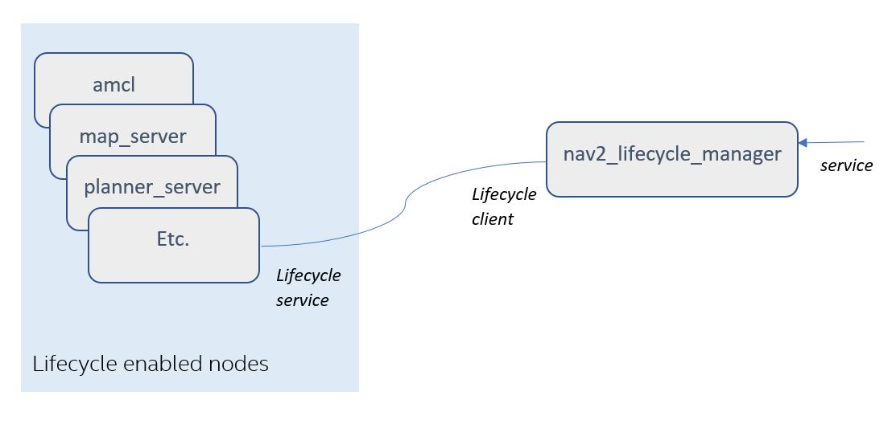
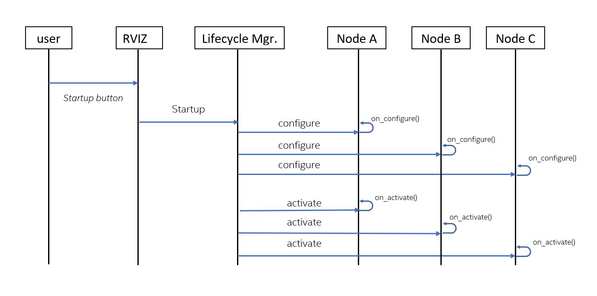

### Background on lifecycle enabled nodes
Using ROS2’s managed/lifecycle nodes feature allows the system startup to ensure that all required nodes have been instantiated correctly before they begin their execution. Using lifecycle nodes also allows nodes to be restarted or replaced on-line. More details about managed nodes can be found on [ROS2 Design website](https://design.ros2.org/articles/node_lifecycle.html). Several nodes in Nav2, such as map_server, planner_server, and controller_server, are lifecycle enabled. These nodes provide the required overrides of the lifecycle functions: ```on_configure()```, ```on_activate()```, ```on_deactivate()```, ```on_cleanup()```, ```on_shutdown()```, and ```on_error()```.

See its [Configuration Guide Page](https://navigation.ros.org/configuration/packages/configuring-lifecycle.html) for additional parameter descriptions.

### nav2_lifecycle_manager
Nav2's lifecycle manager is used to change the states of the lifecycle nodes in order to achieve a controlled _startup_, _shutdown_, _reset_, _pause_, or _resume_ of the navigation stack. The lifecycle manager presents a ```lifecycle_manager/manage_nodes``` service, from which clients can invoke the startup, shutdown, reset, pause, or resume functions. Based on this service request, the lifecycle manager calls the necessary lifecycle services in the lifecycle managed nodes. Currently, the RVIZ panel uses this ```lifecycle_manager/manage_nodes``` service when user presses the buttons on the RVIZ panel (e.g.,startup, reset, shutdown, etc.), but it is meant to be called on bringup through a production system application.

In order to start the navigation stack and be able to navigate, the necessary nodes must be configured and activated. Thus, for example when _startup_ is requested from the lifecycle manager's manage_nodes service, the lifecycle managers calls _configure()_ and _activate()_ on the lifecycle enabled nodes in the node list. These are all transitioned in ordered groups for bringup transitions, and reverse ordered groups for shutdown transitions.

The lifecycle manager has a default nodes list for all the nodes that it manages. This list can be changed using the lifecycle manager’s _“node_names”_ parameter.

The diagram below shows an _example_ of a list of managed nodes, and how it interfaces with the lifecycle manager.


The UML diagram below shows the sequence of service calls once the _startup_ is requested from the lifecycle manager.



### 首次 bond 建连超时清理

- 开机自动启动和 `manage_nodes` 的每个 `STARTUP` 请求只启动一次，不在管理器内部重试或等待重试间隔；保留 `command_board` 原有外层重试。
- 自主导航的 `bond_timeout` 默认 4 秒，路径导航默认 10 秒，同时用于首次建连等待和运行期心跳失联阈值；bond 建连最多等待完整窗口。底层 `ConnectTimeout` 同步使用该值，避免超过默认 10 秒的配置被提前断开。等待返回后还要确认 bond 未断开，不能仅凭 `waitUntilFormed()` 返回 true 判定成功。
- 首次建连超时后，按节点逆序先停用所有 active 节点，再清理所有 inactive 节点，最后清空管理器侧 bond。
- 单个节点清理失败不阻断其余节点清理；后续 `STARTUP` 必须先补做清理，只有清理完成后才允许重新配置和激活。
- 清理未完成时拒绝 `RESUME`，避免对仍处于 inactive 的节点直接执行激活；清理完成并重新启动后，正常暂停、恢复不受此限制。
- 进入启动清理时，将管理器激活标志置为 false 并停止 bond 检查定时器，避免清理过程中或清理失败后错误报告 active。
- 两套导航各自配置参数，不共用配置文件：自主导航使用管理器默认 bond 窗口 4 秒，路径导航在自身 launch 中配置 10 秒。
- `command_board` 分别读取 `nav2.startup_timeout_sec`（60 秒）、`path_navigation.startup_timeout_sec`（300 秒）；该预算不强制取消已发出的 STARTUP。
- 每个管理器独立读取运行后断线重连观察窗口 `bond_respawn_max_duration`，C++ 默认值为 300 秒；节点就绪后即尝试启动，不必等满窗口。管理器不负责重新拉起节点进程，查询及转换请求也可能使实际恢复耗时超出窗口。
- 配置或激活失败沿用原处理。运行后心跳断连的检测、复位和恢复流程保持原样，仍调用原 `startup()`；共享建连函数的等待时间为完整 `bond_timeout`。
- 不新增参数。仅启动清理使用独立的有界服务接口：每次查询或转换的服务发现、响应等待共用 5 秒预算；这是单次调用预算，不是整组清理的总时限。旧服务接口和运行后的恢复流程不变。
- 超时后移除客户端的待处理请求并继续处理其余节点；远端操作可能仍在执行，因此不能视作清理完成。后续 `STARTUP` 仍先查询状态并补做清理，全部确认未配置后才允许启动。
- `test_bond` 覆盖单次请求仅启动一次、外层再次请求成功、部分激活状态清理、清理失败阻止启动，以及停用回复迟到时继续清理其余节点。新增用例模拟 `on_cleanup` 失败，检查 `RESUME` 被拒绝、管理器保持 inactive，以及恢复清理后可以启动并正常暂停、恢复。`test_service_client` 补充服务发现超时、响应超时、迟到回复、待处理请求释放及失败响应检查。新增 C++ 测试尚未构建或运行。
- `test_bond_connection` 单独覆盖 10 秒无对端、等待中对端报告死亡、超过默认连接窗口仍无对端，以及 14 秒窗口内对端在第 11 秒出现的场景；使用真实 bond 实现，检查失败标志及连接状态。该测试已加入 CMake，尚未构建或运行。
